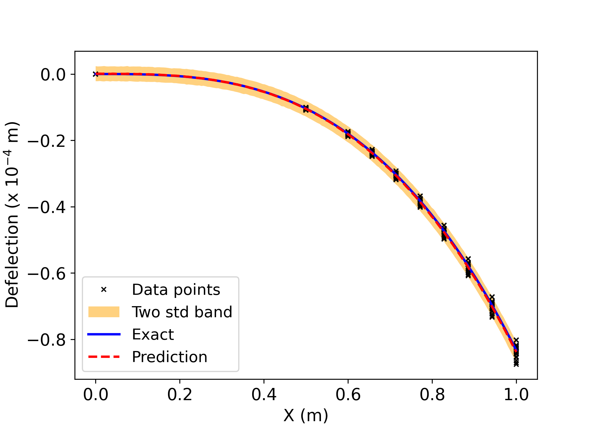

# Adversarial Uncertainty Quantification with Physics-Informed Neural Networks

## Overview

We combined adversarial learning with a physics-informed neural network to investigate variability in a synthetic beam-deflection example. A latent-conditioned generator learns from uncertain observations while an automatic-differentiation residual regularizes its predictions.

This is an attributed portfolio copy of the original three-person project, with its Git history and original notebooks retained.

## Problem

The project studies cantilever-beam response under uncertain material properties and boundary values. Both experiments construct observations from the notebook's cubic reference, `u(x) = -50*x**3/(3*E*I)`, on `0 <= x <= 1`.

One experiment adds Gaussian offsets to endpoint values. The other draws Young's modulus from a Gaussian distribution and generates deflections at interior and endpoint locations. The imposed physics residual remains fixed at its nominal form in both experiments.

## Method

The implementation uses three fully connected networks:

| Network | Purpose | Hidden layers |
| --- | --- | --- |
| Generator/decoder | Maps position and a scalar Gaussian latent variable to deflection | Four layers of 50 units |
| Encoder | Reconstructs the latent variable from position and generated deflection | Four layers of 50 units |
| Discriminator | Distinguishes observed position/deflection pairs from generated pairs | Two layers of 50 units |

Hidden layers use tanh activations and outputs are linear. The discriminator loss applies a sigmoid to its scores. The generator/encoder objective combines an adversarial score, a latent-reconstruction penalty, and the mean squared physics residual. The executed residual is the second-order equation `u_xx + 5*x = 0`, evaluated with the input-normalization correction.

## Experiment

Both notebooks configure 30,000 full-batch training iterations. Each iteration uses one discriminator update and five joint generator/encoder updates, with Adam learning rates of `1e-4`.

| Experiment | Synthetic observations | Collocation points |
| --- | --- | --- |
| [Boundary uncertainty](notebooks/boundary_uncertainty.ipynb) | 20 endpoint pairs with shared Gaussian offsets within each pair | 200 |
| [Material uncertainty](notebooks/material_uncertainty.ipynb) | 20 modulus draws, each evaluated at 10 positions | 100 |

## Predictive uncertainty

The generator is sampled 2,000 times at 200 reference locations. The notebooks compute pointwise sample means and variances, then plot the mean with a two-standard-deviation band. Each sampling pass uses an independent latent value at each coordinate. The displayed band summarizes generated variability; the project does not measure its coverage.

## Technology

Python, TensorFlow through `tensorflow.compat.v1`, NumPy, SciPy, and Matplotlib. Saved notebook outputs identify Python 3.10.12 and TensorFlow 2.16.1. The [requirements](requirements.txt) retain that TensorFlow version and pin the other numerical libraries for the separately documented validation environment.

## Reproducing the experiment

Use an activated Python 3.10 virtual environment:

```bash
git clone https://github.com/nafeezatajenifuja/adversarial-uq-pinns.git
cd adversarial-uq-pinns
python -m pip install -r requirements.txt
python scripts/run_experiment.py --experiment material
```

Select `--experiment boundary` for the other experiment, or open either cleaned notebook in a Jupyter-compatible editor. The default CLI settings retain 30,000 iterations and 2,000 predictive sampling passes. New figures are written under `figures/generated/`.

For a short execution check, use `--iterations 2 --samples 8`; this checks the workflow without reproducing a trained result. See the [numerical and reproduction notes](docs/numerical_notes.md) for environment setup, seed behavior, and scientific qualifications.

## Repository structure

```text
notebooks/
    boundary_uncertainty.ipynb
    material_uncertainty.ipynb
    original/                       # unchanged team notebooks and saved outputs
figures/                            # preserved historical figures
scripts/                            # headless execution and provenance checks
docs/                               # inspection, numerical notes, and portfolio copy
provenance/                         # upstream snapshot and artifact hashes
requirements.txt
references.bib
```

## Results



The black crosses show synthetic observations, the blue curve is the nominal cubic reference, and the dashed red curve is the generated predictive mean. The orange region is the sampled mean plus or minus two standard deviations. This is the existing team-project figure, preserved unchanged. Its original axis label is retained; physical-unit scaling is discussed in the numerical notes.

The notebooks also compute relative Euclidean error of the predictive mean against the nominal reference. They do not include a separate test dataset, uncertainty-calibration study, or benchmark timing comparison.

## Provenance and team

This project was completed collaboratively by Akash Yadav, Taiwo A. Adebiyi, and Nafeezat Ajenifuja as the final project for ELEC/COMP 576, Introduction to Deep Learning, at Rice University.

Original team repository: [TaiwoAdebiyi23/UQPINNS-GANS-ELEC_576-](https://github.com/TaiwoAdebiyi23/UQPINNS-GANS-ELEC_576-).

The original README identifies the team as University of Houston PhD students enrolled in the Rice course. This copy retains the original Git commit and all three team members' attribution. Portfolio organization and reproducibility additions are documented separately from the original scientific work in [the inspection and provenance notes](docs/inspection.md).

## References

The project implements ideas from established adversarial and physics-informed learning methods:

- Goodfellow et al. (2014), [Generative Adversarial Nets](https://proceedings.neurips.cc/paper/2014/hash/f033ed80deb0234979a61f95710dbe25-Abstract.html).
- Yang and Perdikaris (2019), [Adversarial uncertainty quantification in physics-informed neural networks](https://arxiv.org/abs/1811.04026), Journal of Computational Physics, 394, 136–152.

The original bibliography is retained in [references.bib](references.bib), with the broken Goodfellow proceedings link corrected.
